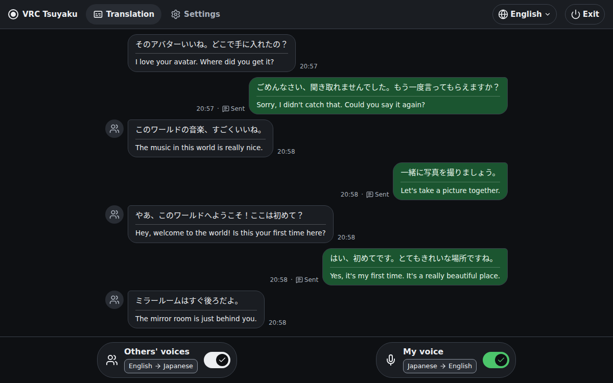

# VRC Tsuyaku

VRC Tsuyaku (通訳, "interpreter") translates speech in VRChat. It writes the translation of your voice into your chatbox, and shows translations of the voices that you hear on a page in your browser.

Speech recognition and translation run on your PC's CPU, not in a cloud service.

Download the latest version from the [Releases page](https://github.com/motoki317/vrc-tsuyaku/releases/latest), and follow the install guide: [English](docs/install.md) · [日本語](docs/install.ja.md).

- [Usage](docs/usage.md): the audio level, and how long a chatbox message stays
- [Glossary](docs/glossary.md): how the words that you register help recognition and translation
- [Models and data](docs/models.md): the model for each language, and what the app downloads, stores and sends
- [Design](docs/design.md): how speech becomes a chatbox message, and which package does each step
- [Development](docs/development.md): build, checks and releases

Built with PLaMo: [PLaMo 3 Translate](https://huggingface.co/pfnet/plamo-3-translate-2b-GGUF) does the translation. The idea comes from [VRCT](https://github.com/misyaguziya/VRCT), a VRChat translator.

VRC Tsuyaku is licensed under the [MIT License](LICENSE). [THIRD_PARTY_NOTICES.md](THIRD_PARTY_NOTICES.md) credits the projects that it draws on, and lists where each download comes from and its license.
