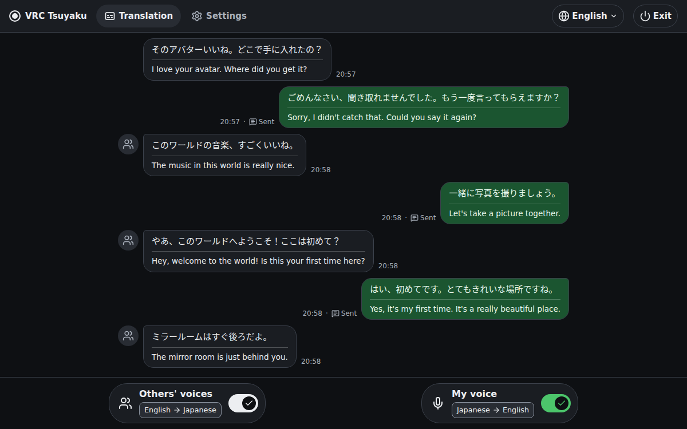

# VRC Tsuyaku

VRC Tsuyaku (通訳, "interpreter") translates speech in VRChat on your PC. It writes the translation of your voice into your chatbox, and shows translations of the voices that you hear. You control it from a page in your browser.

Download the latest version from the [Releases page](https://github.com/motoki317/vrc-tsuyaku/releases/latest), and follow the install guide: [English](docs/install.md) · [日本語](docs/install.ja.md).

- [Usage](docs/usage.md): the two translations, languages, the translation model, and the chatbox message
- [Models and data](docs/models.md): the model for each language, what the app downloads and stores, and its network use
- [Development](docs/development.md): run from source, checks, and releases

Built with PLaMo: [PLaMo 3 Translate](https://huggingface.co/pfnet/plamo-3-translate-2b-GGUF) does the translation. The idea comes from [VRCT](https://github.com/misyaguziya/VRCT), a VRChat translator.

VRC Tsuyaku is licensed under the [MIT License](LICENSE). [THIRD_PARTY_NOTICES.md](THIRD_PARTY_NOTICES.md) credits the projects that it draws on, and lists where each download comes from and its license.
