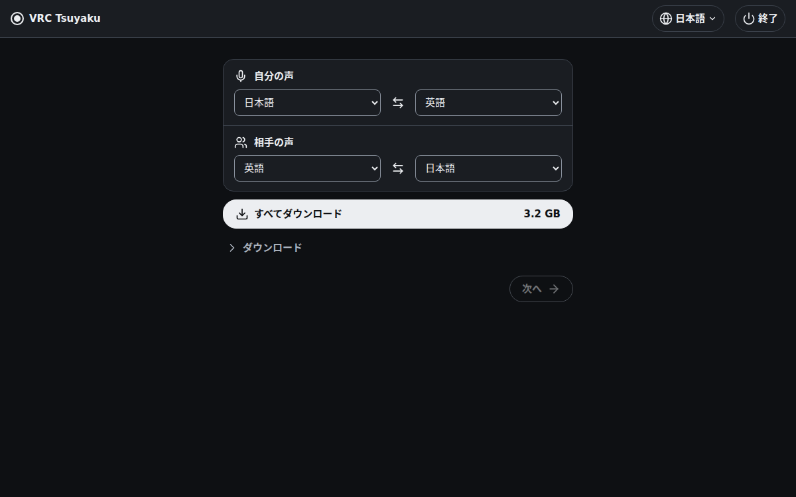

# VRC Tsuyakuのインストール

[English](https://github.com/motoki317/vrc-tsuyaku/blob/main/docs/install.md)

VRC Tsuyakuは64ビット版のWindows 11と、バージョン2004以降の64ビット版のWindows 10で動きます。

## インストールと起動

1. [vrc-tsuyaku-windows.zip](https://github.com/motoki317/vrc-tsuyaku/releases/latest/download/vrc-tsuyaku-windows.zip)をダウンロードします。
2. zipファイルの中の`vrc-tsuyaku.exe`を、ずっと置いておける場所に新しいフォルダーを作って入れます。アプリは設定とモデルをこのフォルダーに保存するので、`Program Files`やOneDriveがバックアップするフォルダーには置かないでください。
3. `vrc-tsuyaku.exe`をダブルクリックします。アプリに署名がないため、Windowsが「WindowsによってPCが保護されました」と表示します。「詳細情報」を押してから「実行」を押してください。

アプリがブラウザーで操作画面を開きます。ここから先は操作画面に沿って進めます。

チャットボックスに何も表示されないときは、VRChatのOSCをオンにしてください。アクションメニューでOptions、OSC、Enabledの順に選びます。

## 更新

アプリを終了し、zipファイルをもう一度ダウンロードして、フォルダーの`vrc-tsuyaku.exe`をその中のものに置き換えます。設定とモデルはそのまま残ります。

## アンインストール

アプリを終了してから、フォルダーごと削除します。アプリはこのフォルダーの外に何も書き込みません。

## Linux

[vrc-tsuyaku-linux.tar.gz](https://github.com/motoki317/vrc-tsuyaku/releases/latest/download/vrc-tsuyaku-linux.tar.gz)をダウンロードして展開し、`vrc-tsuyaku/vrc-tsuyaku`を実行します。PulseAudio、または`pipewire-pulse`を入れたPipeWireが必要です。Linuxでの「相手の声」はテスト用の再生プログラムでしか試しておらず、Proton上のVRChatでは試していません。
