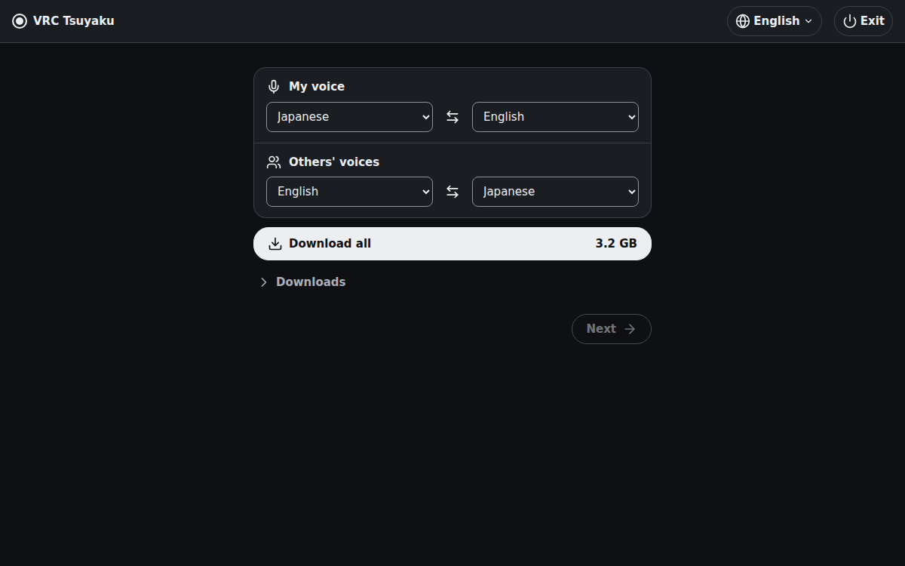

# Install VRC Tsuyaku

[日本語](https://github.com/motoki317/vrc-tsuyaku/blob/main/docs/install.ja.md)

VRC Tsuyaku runs on 64-bit Windows 11, and on 64-bit Windows 10 from version 2004.

## Install and start

1. Download [vrc-tsuyaku-windows.zip](https://github.com/motoki317/vrc-tsuyaku/releases/latest/download/vrc-tsuyaku-windows.zip).
2. Put `vrc-tsuyaku.exe` from the zip into a new folder, in a place where it can stay. The app saves its settings and models in this folder, so do not use `Program Files` or a folder that OneDrive backs up.
3. Double-click `vrc-tsuyaku.exe`. Windows shows "Windows protected your PC" because the app is not signed: click "More info", then "Run anyway".

The app opens its page in your browser, and the page leads you from there.

If your chatbox stays empty, turn on OSC in VRChat: Action Menu → Options → OSC → Enabled.

## Update

Exit the app, download the zip again, and replace `vrc-tsuyaku.exe` with the one in it. Your settings and models stay.

## Uninstall

Exit the app and delete its folder. The app writes nothing outside that folder.

## Linux

Download [vrc-tsuyaku-linux.tar.gz](https://github.com/motoki317/vrc-tsuyaku/releases/latest/download/vrc-tsuyaku-linux.tar.gz), extract it, and run `vrc-tsuyaku/vrc-tsuyaku`. The app needs PulseAudio, or PipeWire with `pipewire-pulse`. On Linux, "Others' voices" is tested only with test playback programs, not with VRChat under Proton.
