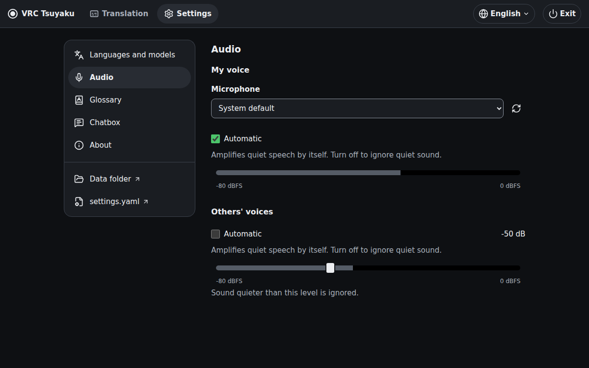
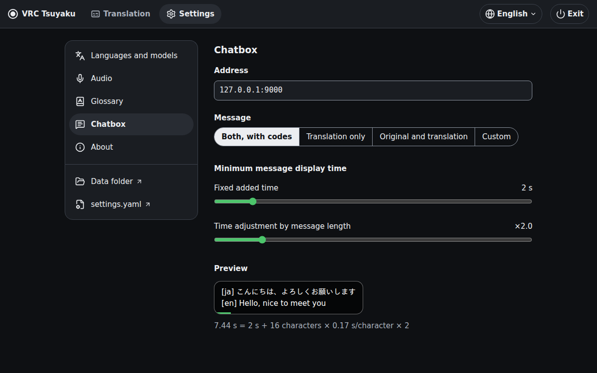

# Using VRC Tsuyaku

## Others' voices

"Others' voices" hears everything that VRChat plays, so it also translates songs with vocals and video players.

## Audio level

"Automatic" adjusts its gain to the louder voice, so the app can miss a quiet talker while someone louder also talks. In that case, turn "Automatic" off and drag the slider to about −70 dB. There the app ignores almost nothing and amplifies quiet sound the most.

If speech hardly moves the meter, no setting helps. Raise the microphone's level in Windows, or the voice volume in VRChat.

## Chatbox message

A new message replaces the one in your chatbox, so the app waits a minimum display time before it sends the next one. With the default settings, the app sends a message at most about 14 seconds after its translation, even if the previous message's minimum display time has not ended.

Each viewer's VRChat hides a message after a time that the viewer set in VRChat, 60 seconds at most, even when the minimum display time is longer.
